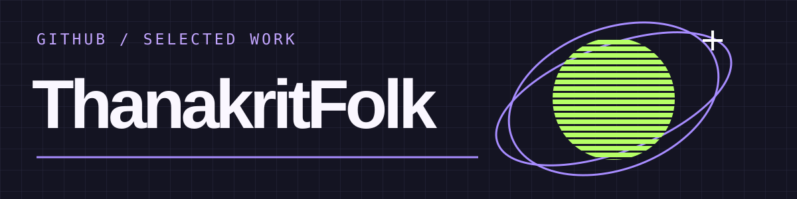

# Thanakrit Yaiwong

สวัสดีครับ ผม **ธนกฤต ใหญ่วงศ์** ✌️

ผลงานชิ้นหนึ่งของผมเริ่มจากคำถามง่าย ๆ ว่า ถ้าคำอวยพรวันเกิดเป็นเว็บที่ค่อย ๆ เปิดให้สำรวจทีละส่วน จะออกมาเป็นยังไง?

 

## 🎧 Mypuppy

เว็บอวยพรวันเกิดที่เปิดด้วยแป้นกดรหัส แล้วพาคนรับเข้าไปดูภาพพร้อมฟังเพลงประกอบ ผมใช้ Canvas วาดดาวบนหน้าจอ และให้หัวใจลอยขึ้นระหว่างดูภาพ

`HTML` · `CSS` · `JavaScript` · `Canvas 2D`

[อ่านเบื้องหลังการทำ Mypuppy →](./PORTFOLIO.md)　[ดูโปรเจกต์บน GitHub ↗](https://github.com/ThanakritFolk/Mypuppy)
